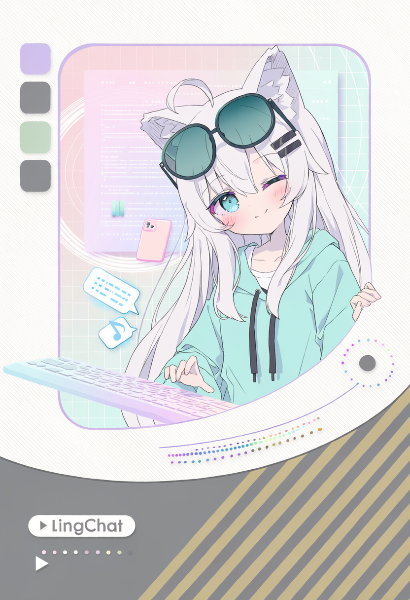
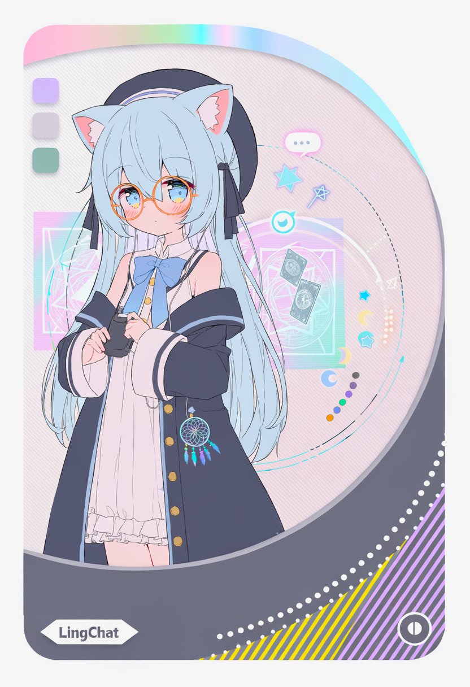
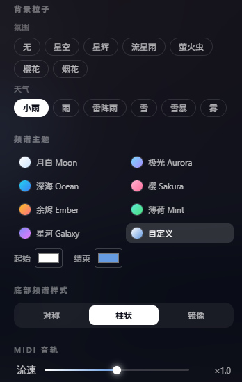

<div align="center">


[](https://vuejs.org/)
[](https://vite.dev/)
[](https://tailwindcss.com/)
[](https://www.typescriptlang.org/)
[](LICENSE)
[](https://github.com/Stellar-Moon-Team/LingMusic/pulls)

**LingMusic - 为 LingChat OST 打造的沉浸式音乐可视化舞台**

一首歌、一张海报，一片会呼吸的夜空。

[🎵 项目介绍](#-项目介绍) · [🚀 快速开始](#-快速上手指南) · [📸 实机画面](#-实机画面) · [🐛 报告 Bug](https://github.com/Stellar-Moon-Team/LingMusic/issues)

</div>

---

## 🎵 项目介绍

**LingMusic** 是一个音乐播放 MIDI 可视化页面，为 [LingChat](https://github.com/SlimeBoyOwO/LingChat) 的原声带而做。

页面左侧是角色海报，背景随曲目切换到星空、夜晚、夕阳、樱花或占卜摊，并叠加实时粒子；右侧是曲名、专辑、作曲与随播放进度轮换的短句；右上示波线、底部柱状频谱和右下发光 MIDI 音轨都会跟着音乐一起律动。

整个舞台按 1920×1080 设计并等比缩放，适合直接投屏、录屏，或作为 OBS 浏览器源使用。

---

## ✨ 核心功能

1. 🎴 **沉浸式舞台**：海报、氛围背景、粒子、曲目信息组成 1920×1080 等比缩放的完整画面，窗口怎么变都不会错位。
2. 🎹 **实时频谱**：通过 Web Audio `AnalyserNode` 读取当前音频，支持对称、柱状、镜像三种底部频谱样式。
3. 🌈 **频谱主题**：月白、极光、深海、樱、余烬、薄荷、星河，以及可自由取色的「自定义」主题。
4. 🎼 **发光 MIDI 音轨**：解析标准 MIDI 文件，按声部取渐变颜色，音符从右向左流过播放线，经过时点亮左侧小键盘。
5. 🌌 **背景与粒子**：内置星空、夜晚、夕阳、樱花、占卜摊五张背景；星空、星辉、流星雨、萤火虫、烟花、雨、雷阵雨、雪、雪暴、雾等多种粒子。
6. 💬 **短句轮换**：纯音乐不需要歌词，用两句一组的短句按播放进度均分轮换，每一首都能写出自己的氛围。
7. 💾 **按曲独立设置**：背景、粒子、频谱主题、界面开关、播放进度都按曲目保存在浏览器本地，下次打开接着听。
8. ⌨️ **快捷键与隐藏界面**：空格播放/暂停、方向键快退快进、`H` 一键隐藏全部 UI、`F` 全屏，录屏时非常好用。
9. 🎥 **OBS 友好**：支持 `?autoplay`、`?clean`、`?t=60` 地址栏参数，浏览器源打开即播、无界面、从指定秒数开始。
10. 🧩 **容易扩展**：新增歌曲只需在 `src/data/tracks.ts` 里加一项，新增背景只需在 `src/data/backgrounds.ts` 里加一项。

---

## 🎴 角色音乐海报

<table width="100%">
  <tr>
  <td align="center" width="33%">
      
      <h4>Leisurely Moments<br><sub>闲 适 时 光</sub></h4>
    </td>
    <td align="center" width="33%">
      
      <h4>Starscape<br><sub>星 景</sub></h4>
    </td>
    <td align="center" width="33%">
      
      <h4>Stolen Nap<br><sub>偷 闲 小 憩</sub></h4>
    </td>
  </tr>
</table>

---

## 📸 可定制化

<table width="100%">
  <tr>
    <td align="center" width="50%">
      
      <h4>🎵 曲目切换与背景选择</h4>
    </td>
    <td align="center" width="50%">
      
      <h4>🎛️ 粒子、频谱主题、底部样式与 MIDI 音轨设置</h4>
    </td>
  </tr>
</table>

---

## 🚀 快速上手指南

### 🔧 准备工作

> [!NOTE]
> 需要 **Node.js 18+**（推荐 20 或更高）与 npm。本项目是纯前端页面，不需要任何后端服务或 API Key。

### 📦 第一步：安装依赖

```bash
git clone https://github.com/Stellar-Moon-Team/LingMusic.git
cd LingMusic
npm install
```

### 🎧 第二步：启动

```bash
npm run dev      # 开发模式，http://localhost:5173
npm start        # 构建并预览，http://localhost:4173
```

Windows 下也可以直接双击 **`启动展示.bat`**，首次运行会自动安装依赖。

> [!WARNING]
> 请通过本地服务器访问，不要直接双击 `dist/index.html`。频谱依赖 Web Audio 读取音频数据，`file://` 协议下浏览器会拒绝。

---

## ⌨️ 操作说明

| 按键    | 作用                             |
| ------- | -------------------------------- |
| `空格`  | 播放 / 暂停                      |
| `←` `→` | 后退 / 前进 5 秒                 |
| `H`     | 隐藏全部界面（录屏用），再按恢复 |
| `F`     | 全屏                             |
| `S`     | 打开 / 关闭展示设置              |

鼠标静止 2.6 秒后播放条自动隐藏。曲目多于一首时，舞台两侧会出现切歌箭头，播完自动切到下一首。

### 地址栏参数

适合 OBS 浏览器源、自动播放展示等场景：

| 参数        | 作用               |
| ----------- | ------------------ |
| `?autoplay` | 打开即播放         |
| `?clean`    | 打开即隐藏全部界面 |
| `?t=60`     | 从第 60 秒开始     |

例如 `http://localhost:4173/?autoplay&clean` 打开就是一个干净、自动播放的舞台。

---

## 🎼 添加新歌

1. 音频放到 `public/media/music/`，海报放到 `public/media/posters/`（建议 832×1216 竖版），MIDI（可选）放到 `public/media/midi/`
2. 在 `src/data/tracks.ts` 的 `TRACKS` 里加一项：

```ts
{
  id: "new-song",
  title: "New Song",
  subtitle: "新 歌",                 // 可选
  artist: "the_last_summer",
  album: "LingChat OST",
  src: "media/music/new-song.ogg",
  midi: "media/midi/new-song.mid",   // 可选；没有就不显示音轨
  midiOffset: 0,                     // 可选；音轨比声音早就填正数（秒）
  poster: "media/posters/xxx.png",
  background: "night",               // 见 src/data/backgrounds.ts
  particle: "Fireflies",             // 见 src/data/particles.ts
  palette: "aurora",                 // 见 src/data/palettes.ts
  spectrumStyle: "bars",             // 底部频谱：bars | symmetric | mirror
  lines: [
    ["第一组上句", "第一组下句"],
    ["第二组上句", "第二组下句"],
  ],
}
```

每组两句连成一行作为标语，按播放进度均分轮换；没有 `lines` 时也不会报错，只是不显示短句。

新增背景：图片放进 `public/media/bg/`，在 `src/data/backgrounds.ts` 加一项即可。

> [!IMPORTANT]
> 仓库不包含 MIDI 文件（`public/media/midi/` 已加入 `.gitignore`）。如果你克隆后想看到右下角的发光音轨，请自行把对应的 `.mid` 文件放进该目录，并保证 `tracks.ts` 里的 `midi` 路径一致；缺少 MIDI 时页面会正常播放，只是不显示音轨。

---

## 📁 项目结构

```
.
├─ index.html
├─ vite.config.ts
├─ LICENSE                       # MIT
├─ 启动展示.bat                  # Windows 一键构建并启动
├─ docs/images/                  # README 预览图
├─ public/
│  ├─ fonts/                     # 标题字体子集
│  └─ media/
│     ├─ music/                  # 音频
│     ├─ midi/                   # MIDI（不随仓库分发）
│     ├─ posters/                # 角色海报
│     └─ bg/                     # 氛围背景
└─ src/
   ├─ App.vue                    # 舞台（1920×1080 等比缩放）、播放逻辑、快捷键、逐帧绘制
   ├─ components/                # 背景层、粒子层、海报、曲目信息、播放条、设置面板
   ├─ composables/useAudioEngine # <audio> + AnalyserNode 单例
   ├─ lib/spectrum.ts            # 频谱采样与绘制（移植自 LingChat）、示波线
   ├─ lib/midi.ts                # 标准 MIDI 文件解析（音符、速度表、拍号）
   ├─ lib/noteRoll.ts            # 发光 MIDI 音轨绘制
   ├─ particles/                 # 粒子组件（原样拷贝自 LingChat）
   └─ data/                      # 曲目、背景、粒子、频谱主题、设置持久化
```

---

## 🔗 致谢与开源灵感

本项目的画面、频谱与粒子都来自 LingChat 的积累，感谢这些优秀的开源作品 🌼：

- **[LingChat](https://github.com/SlimeBoyOwO/LingChat)**：本项目的一切起点。频谱渲染与粒子特效移植自 LingChat，曲目来自 LingChat OST。
- **[Vue 3](https://vuejs.org/)**、**[Vite](https://vite.dev/)**、**[Tailwind CSS](https://tailwindcss.com/)**：让这个页面能又快又轻地跑起来。
- **the_last_summer**：LingChat OST 的作曲者，三首曲子的创作者。

---

## 📄 许可证

- **代码：** 本项目采用 [MIT License](LICENSE) 开源。
- **美术资源：** 海报与插图由 NovelAI 生成，本项目不对其主张版权。
- **音乐：** 曲目的授权与使用条件以 [`public/media/music/LICENSE.txt`](public/media/music/LICENSE.txt) 中的说明为准（CC BY-NC 4.0：署名 · 非商业性使用）。

---

## ⚠️ 免责声明

<details>
<summary><b>点击展开</b></summary>

> - **美术资源：** 海报与插图由 NovelAI 生成，本项目不对其主张版权，请勿用于不当用途。
> - **音乐：** 曲目授权以 [`public/media/music/LICENSE.txt`](public/media/music/LICENSE.txt) 为准，默认不可商用。
> - **MIDI：** 仓库不分发 MIDI 文件；自行添加的文件请确认拥有相应使用权。
> - **责任声明：** 本项目仅用于学习与展示，请对自己的使用行为负责。

</details>

---

## ⭐️ 喜欢这个项目吗？

如果这个页面让你觉得好听又好看，欢迎点一个 Star，也欢迎到 LingChat 看看我们还在做什么。

<a href="https://github.com/Stellar-Moon-Team/LingMusic">
  
</a>

<a href="https://www.star-history.com/?repos=Stellar-Moon-Team%2FLingMusic&type=date&legend=top-left">
 <picture>
   <source media="(prefers-color-scheme: dark)" srcset="https://api.star-history.com/chart?repos=Stellar-Moon-Team/LingMusic&type=date&theme=dark&legend=top-left" />
   <source media="(prefers-color-scheme: light)" srcset="https://api.star-history.com/chart?repos=Stellar-Moon-Team/LingMusic&type=date&legend=top-left" />
   
 </picture>
</a>

_© Stellar Moon Team · LingMusic_
